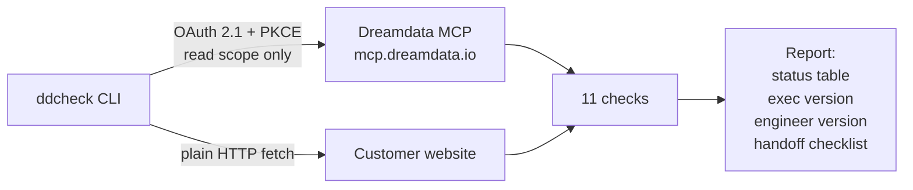

# ddcheck: onboarding health checks for Dreamdata

A command-line tool for the person onboarding a customer onto [Dreamdata](https://dreamdata.io). It signs in to the **Dreamdata MCP server**, runs 11 read-only checks on a workspace, and writes a handoff report in two versions: one for the engineer who fixes things and one for the exec who pays for them.

It answers the question every onboarding call starts with: *is this workspace actually producing usable data yet, and if not, what's blocking it?*

```
$ ddcheck run --domain iwamedia.com

'Iwa Media (ucsd_edu)  ->  Blocked

   1  FIX      Workspace access and identity: Reachable as "'Iwa Media", but the slug "ucsd_edu" looks like it came from a signup email domain
   2  PASS     Currency: USD
   3  PASS     Tracker on live site: Dreamdata script found in the page HTML of https://iwamedia.com/
   4  WAITING  Events in the model (7 days): 0 events, 0 sessions, 0 visitors
   5  WAITING  Non-production traffic: No events yet, so hosts can't be checked
   6  WAITING  Visitors becoming known contacts: 0 visitors, 0 contacts
   7  CHECK    Ad platform data (30 days): 0 ad impressions
   8  WAITING  Companies resolving: 0 companies
   9  BLOCKER  Pipeline stages: No pipeline stages available
  10  WAITING  Signals firing (30 days): 0 signal hits
  11  TODO     Audiences and saved reports: 0 audiences, 0 saved reports
```

That's a real result: my own agency's workspace, the evening I set it up. Full report: [examples/sample-report.md](examples/sample-report.md) · [HTML version](examples/sample-report.html).

> Unofficial. Built by a Dreamdata customer, not affiliated with Dreamdata.

## Why it exists

I onboarded my agency, 'Iwa Media, onto Dreamdata myself: HubSpot, Meta Ads, the tracker on our site, a high-intent signal. Afterwards the UI looked set up, but every report was empty. Was the install broken, or was the data still processing?

Checks 3 and 4 together answer that in one run. The tracker is on the live site (3) but nothing has reached the model yet (4), so it's a modeling delay, not a broken install. That's the difference between telling a customer "give it a day" and opening a ticket.

Check 9 found the real blocker: no pipeline stages. Without stages, attribution has no outcome to credit, so the tracking can be perfect and still produce zero insight.

## Quick start

You need Python 3.11+. The easiest way on a Mac is [uv](https://docs.astral.sh/uv/), which brings its own Python:

```bash
curl -LsSf https://astral.sh/uv/install.sh | sh          # once
uv tool install git+https://github.com/ka1saucedo/dreamdata-health-check

ddcheck demo                                # try it on the recorded workspace, no sign-in
ddcheck login                               # opens your browser once to sign in to Dreamdata
ddcheck run --domain yourcustomer.com       # check a workspace, write reports/
```

Or with pip: `pip install git+https://github.com/ka1saucedo/dreamdata-health-check`.

**Status: v0.1.** The checks, reports and MCP protocol path are tested against recorded real responses (see Testing). If sign-in or a check misbehaves on your workspace, open an issue with the error.

## Commands

| Command | What it does |
|---|---|
| `ddcheck login` | Sign in through Dreamdata's OAuth page and list the workspaces you can access |
| `ddcheck run [-w SLUG] [-d DOMAIN] [--setup-hours N]` | Check one workspace. Writes Markdown, HTML and JSON to `reports/` |
| `ddcheck fleet` | Check **every** workspace you can access and write a one-table summary, worst first |
| `ddcheck demo` | Run on a recorded real workspace, no sign-in needed |
| `ddcheck logout` | Delete cached tokens |

`--setup-hours` matters: zero data inside the first 24 hours is `WAITING` (normal modeling delay). After 24 hours the same result becomes `FIX`.

Exit codes: `0` ready for handoff, `2` not ready, `1` error. That makes it usable in scripts and scheduled jobs.

## The 11 checks

| # | Check | How | Flags |
|---|---|---|---|
| 1 | Workspace identity | `list_my_accounts` | Slug taken from a signup email domain (e.g. `ucsd_edu`) |
| 2 | Currency | `get_account_currency` | No currency, so revenue and ROI are unlabeled |
| 3 | Tracker on live site | Fetches the customer's page HTML | Dreamdata script missing; detects GTM installs |
| 4 | Events in the model | Engagement report, last 7 days, by host and event | Zero events; tells a modeling delay apart from a broken install |
| 5 | Non-production traffic | Same report, by host | Netlify/Vercel previews, staging and localhost inflating counts |
| 6 | Visitors to contacts | Same report | Visitors but no known contacts: form tracking or identify missing |
| 7 | Ad platform data | Engagement report, last 30 days, by channel | Zero impressions: no live campaigns or a broken connection |
| 8 | Companies resolving | `search_companies` | No companies after modeling |
| 9 | Pipeline stages | `report_builder_list_subjects` | **No stages = no attribution** |
| 10 | Signals firing | Engagement report by signal name | No signal hits |
| 11 | Audiences and reports | `list_audiences`, `list_saved_reports` | Nothing built yet |

Statuses: `BLOCKER` · `FIX` · `CHECK` (needs a human look) · `WAITING` (data still processing) · `TODO` · `SKIPPED` · `PASS`.

## How it works



Design decisions:

- **Read-only by construction.** It requests only Dreamdata's `read` OAuth scope and never calls a save or create tool. A health check shouldn't be able to change a customer's workspace.
- **No hard-coded ids.** Every report config is built from the metric and property ids that `report_builder_get_components` returns for that workspace, looked up by label.
- **Honest statuses.** Results are printed exactly as returned. A failed query becomes `CHECK` with the error, never a guess. Zero data is `WAITING` or `FIX` depending on setup age, not silently "fine".
- **Two audiences, one run.** The exec version is plain English with no ids or jargon, and a test enforces that.
- **Tokens stay out of the repo.** OAuth tokens live in `~/.config/ddcheck/` with file mode 600.

## Testing

```bash
pip install -e ".[dev]" anyio uvicorn
pytest -q
```

- `tests/fixtures/iwa_media_2026-11-14.json` holds **real Dreamdata MCP responses** from my workspace, recorded the night of setup. Nothing in it is invented.
- `test_mcp_roundtrip.py` starts a local MCP server that replays those responses over streamable HTTP, and runs the real client against it, so the protocol path is tested end to end.
- The "populated workspace" test adds synthetic rows on top of the recording to exercise the branches an empty workspace can't reach (preview traffic, missing identify calls). Those rows are labeled as test data in the code.

## Also included: the Claude skill

[`skill/SKILL.md`](skill/SKILL.md) is the same check written as a Claude skill. With the Dreamdata MCP connected to Claude, you can ask "run a health check on my workspace" and get the same report in conversation. The CLI is for repeatable runs and checking every workspace at once. The skill is for ad hoc questions and for customers building on the MCP themselves.

## Roadmap

- Cross-check HubSpot directly: deals without stages, owners missing, lifecycle fields empty
- Scheduled `fleet` run with a Slack digest of workspaces that got worse
- Before/after diff between two runs of the same workspace

---

Built by [Kai Saucedo](https://kaisaucedo.com).
